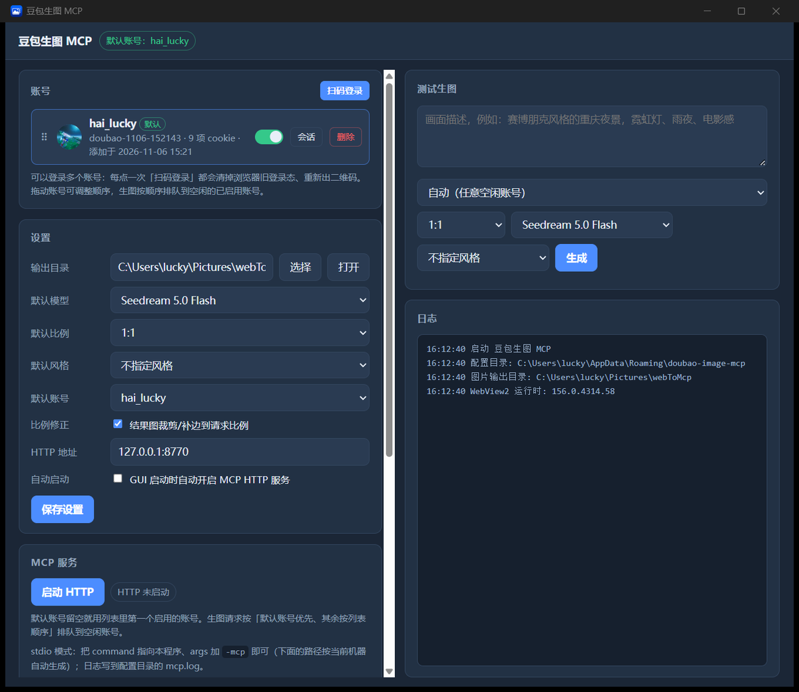

# 豆包生图 MCP（doubao-image-mcp）

把**豆包网页版**（doubao.com）的生图能力封装成本地 MCP 服务：**不需要官方 API Key**，用你自己的网页登录态直接调用，Seedream 4.0 / 4.5 / 5.0 全系可用。附带一个桌面端（Wails + WebView2），负责扫码登录、多账号管理、测试生图与排障。

> Local MCP server that exposes Doubao's web image generation as tools for Claude Desktop / Cursor / any MCP client — no API key, just your own web session.



## 目录

- [它能做什么](#它能做什么)
- [环境要求](#环境要求)
- [安装](#安装)
- [首次使用](#首次使用)
- [接入 MCP 客户端](#接入-mcp-客户端)
- [工具参考](#工具参考)
- [多账号与自动排队](#多账号与自动排队)
- [数据位置](#数据位置)
- [排障](#排障)
- [已知限制](#已知限制)
- [跨平台说明](#跨平台说明)
- [开发](#开发)

## 它能做什么

MCP 对外提供 5 个工具：

| 工具 | 作用 |
| --- | --- |
| `doubao_image` | 文生图 / 图生图。**一次生成几张就返回几张**：本地文件路径 + CDN 链接 + 尺寸 |
| `doubao_login` | **直接从 AI 客户端弹窗扫码**：没有账号或登录态失效时调它，不用切到 GUI |
| `doubao_models` | 列出可用模型、32 种风格 key、8 种比例 |
| `doubao_ping` | 检查当前账号登录态是否有效（也能发现 IP 风控） |
| `doubao_accounts` | 账号池：列出 / 切换默认 / 启用 / 停用 / 删除，输出带昵称与忙碌状态 |

`doubao_login` 的关键点：stdio 模式下 MCP 进程同样跑在你的桌面会话里，所以它能直接开一个 WebView2 扫码窗口（最多等 3 分钟，扫完自动保存账号并校验）。**已经有可用账号时不会打扰你**，直接返回「无需登录」。mac / Linux 因为没有内置浏览器，会提示改用 `-set-session`。

几个实现上的点，用起来能感觉到：

- **无水印直链**：从 SSE 里挑 `image_raw` / `dwm3` 模板地址（手工改后缀会 400，签名覆盖整个 path，只能用服务端给的）。
- **多图全量**：服务端一次可能给 1~4 张，全部返回；结构化解析漏掉的图会从原文按图补回。
- **比例修正**：服务端经常忽略请求比例，默认用虚化背景补齐到目标比例（偏差 3% 内不动）。
- **双通道降级**：新端点 `/chat/completion` 失败自动降级到旧的 samantha 通道。

## 环境要求

- **Windows 10 / 11**：完整支持（GUI + 扫码登录），x64 / x86 / ARM64 都有预编译包。
- **macOS / Linux**：有预编译**命令行版**（MCP 功能完整），但没有 GUI、没有内置扫码登录，登录用 `-set-session` 手动导入（见[安装 → 方式三](#方式三macos--linux)）。想要 GUI 就在该平台上自己 `wails build`。
- [Microsoft Edge WebView2 Runtime](https://developer.microsoft.com/microsoft-edge/webview2/)：仅 Windows 的扫码窗口需要；Win11 自带，Win10 若缺失程序会明确提示。
- 一个豆包账号（免费账号就能用 Seedream 5.0 Flash）。

## 下载

到 [Releases](../../releases/latest) 按你的平台选一个：

| 平台 | 资产 | 形态 |
| --- | --- | --- |
| Windows x64 | `…-windows-amd64.zip` | GUI 完整版 |
| Windows ARM64 | `…-windows-arm64.zip` | GUI 完整版 |
| Windows x86（32 位） | `…-windows-386.zip` | GUI 完整版（老机器） |
| macOS Apple Silicon | `…-darwin-arm64-cli.zip` | 命令行版 |
| macOS Intel | `…-darwin-amd64-cli.zip` | 命令行版 |
| Linux x64 | `…-linux-amd64-cli.zip` | 命令行版 |
| Linux ARM64 | `…-linux-arm64-cli.zip` | 命令行版 |

> **命令行版**包含 `-mcp`（stdio）、`-http`、`-set-session`、`-diagnose`、`-view` 等全部命令，只是没有图形界面。
> 每个包都是「可执行文件 + README + LICENSE」，解压即用。mac/Linux 上首次运行可能需要 `chmod +x doubao-image-mcp`。

## 安装

### 方式一：下载 Release（推荐）

**Windows**：

1. 下载 `…-windows-amd64.zip`（ARM 机器选 arm64，32 位系统选 386）
2. 解压到任意目录（路径可以含中文和空格）
3. 双击 `doubao-image-mcp.exe`

程序是单文件，不需要安装。配置和账号写在 `%APPDATA%\doubao-image-mcp`，所以移动/改名 exe 不会丢账号。

**macOS / Linux（命令行版）**：

```bash
unzip doubao-image-mcp-v1.0.0-darwin-arm64-cli.zip -d doubao-image-mcp
cd doubao-image-mcp && chmod +x doubao-image-mcp
./doubao-image-mcp -set-session "<从浏览器复制的 sessionid>"
./doubao-image-mcp -mcp        # MCP 客户端拉起时用
```

首次从网上下载的二进制在 macOS 上可能被 Gatekeeper 拦，执行 `xattr -d com.apple.quarantine ./doubao-image-mcp` 即可。

### 方式二：从源码构建

需要 Go 1.22+、Node.js 18+、[Wails CLI](https://wails.io/docs/gettingstarted/installation)：

```powershell
go install github.com/wailsapp/wails/v2/cmd/wails@latest
git clone <本仓库>
cd doubao-image-mcp
wails build          # 产出 build\bin\doubao-image-mcp.exe
```

只改后端时可以 `go build ./...` 快速验证编译。

### 方式三：macOS / Linux

MCP 本体（协议客户端、工具、账号池）是纯 Go，可以直接跑；**缺的只是 Windows 那个内置扫码窗口**，所以登录改成手动导入 `sessionid`。

```bash
# 需要 Go 1.22+
go build -o doubao-image-mcp .

# 1) 手动导入登录态：在浏览器登录豆包网页版，
#    从开发者工具 → Application → Cookies 里复制 sessionid（可选 ttwid）
#    导入时会顺带校验登录态、抓头像和昵称
./doubao-image-mcp -set-session "<粘贴 sessionid>" -ttwid "<可选>"

# 2) 交给 MCP 客户端（stdio 模式）
./doubao-image-mcp -mcp
```

想要 GUI 的话：

```bash
# macOS：需要 Xcode 命令行工具（xcode-select --install）
# Linux：需要 GTK/WebKit2GTK 开发包，例如 Debian/Ubuntu:
#   sudo apt install libgtk-3-dev libwebkit2gtk-4.1-dev
go install github.com/wailsapp/wails/v2/cmd/wails@latest
wails build
```

mac/Linux 上的 GUI 里，「扫码登录」按钮会换成**手动导入 sessionid** 的输入框，其余功能（账号池、排队、测试生图、大图查看、另存）都一样。

> **未验证**：作者只有 Windows 机器，mac/Linux 只验证到「交叉编译通过」（`GOOS=darwin` / `GOOS=linux go build .` 都能出二进制）。真实运行、GUI 渲染、`open`/`xdg-open` 打开目录需要 macOS / Linux 用户帮忙验证；有问题请开 issue 附上 `-diagnose` 报告。

## 首次使用

1. 打开程序，点账号卡片右上角的 **「扫码登录」**（mac/Linux 是「导入 sessionid」）。
2. 弹出内置浏览器窗口，用豆包 App 扫码，窗口自动关闭。
3. 账号出现在列表里，带**头像 + 昵称**（登录成功后自动抓取）。
4. 在「设置」里选好输出目录（默认 `图片\doubao-image-mcp`）、默认模型/比例/风格。

**加第二个账号**：再点一次「扫码登录」。程序会先清空浏览器里的旧登录态、重新出二维码，并且把已有账号的 `sessionid` 排除在外，所以不会出现「一打开就显示已登录、第二个号扫不进去」的情况。

**排序与默认账号**：账号行可以拖动排序（顺序就是生图优先级）；「设置 → 默认账号」可以指定优先用哪个号，留空则用列表里第一个启用的账号。停用的账号不参与调度，也不会出现在两个账号下拉里。

## 接入 MCP 客户端

客户端配置里的路径**不要手抄**：GUI 的「MCP 服务」卡片会按当前机器的真实位置生成好可直接粘贴的 JSON，`doubao-image-mcp.exe -diagnose` 也会打印同一份。

### 方式一：stdio（推荐，客户端自己拉起进程）

```json
{
  "mcpServers": {
    "doubao": {
      "command": "C:\\Users\\<你>\\Downloads\\doubao-image-mcp.exe",
      "args": ["-mcp"]
    }
  }
}
```

- **Claude Desktop**：改 `%APPDATA%\Claude\claude_desktop_config.json`，重启客户端。
- **Cursor**：`Settings → MCP → Add new MCP server`，选 `command` 类型，命令填 `<路径>\doubao-image-mcp.exe -mcp`。
- **Cherry Studio / 其他**：选「stdio」传输，命令和参数同上。

`-mcp` 模式下日志写到 `%APPDATA%\doubao-image-mcp\mcp.log`，stdout 只走 JSON-RPC，不会污染协议。

### 方式二：本地 HTTP（常驻，多客户端共用）

在 GUI 里点「启动 HTTP」，或命令行：

```powershell
.\doubao-image-mcp.exe -http 127.0.0.1:8770   # 不带地址则用配置里的地址
```

客户端配置：

```json
{
  "mcpServers": {
    "doubao": {
      "type": "http",
      "url": "http://127.0.0.1:8770/mcp"
    }
  }
}
```

> ⚠️ 这个 HTTP 接口**没有鉴权**，等于「谁连上谁就能花你的额度」。默认只绑 `127.0.0.1`，不要改成 `0.0.0.0` 或局域网地址。

### 怎么确认接上了

在客户端里问一句「用 doubao_ping 看看豆包登录态」，返回 `账号 xxx 登录态正常` 就通了。返回「还没有登录任何豆包账号」说明账号不在配置里，回 GUI 扫码即可。

## 工具参考

### `doubao_image` —— 生成图片

| 参数 | 类型 | 必填 | 说明 |
| --- | --- | --- | --- |
| `prompt` | string | ✅ | 画面描述，越具体越好 |
| `ratio` | string | | `1:1` `4:3` `3:4` `16:9` `9:16` `3:2` `2:3` `auto`；留空用配置默认 |
| `model` | string | | `Seedream 5.0 Flash`（免费，推荐）/ `Seedream 4.5` / `Seedream 4.0` / `Seedream 5.0 Pro`（需订阅） |
| `style` | string | | 风格 `option_key`，32 种，用 `doubao_models` 查 |
| `ref_images` | string[] | | 本地绝对路径数组，传了就走**图生图** |
| `out_dir` | string | | 保存目录；留空用配置里的输出目录 |
| `fit_ratio` | bool | | 是否裁剪/补边到请求比例；留空跟随配置（默认开） |
| `timeout_seconds` | int | | 超时秒数，默认 180 |
| `inline` | bool | | 为 true 时把图片本体以 base64 放进 MCP 响应（体积大），默认只给路径/链接 |

返回的文本是「共 N 张：」加每张一行路径；结构化输出：

```json
{
  "prompt": "海边日落，电影感",
  "model": "Seedream 5.0 Flash",
  "ratio": "16:9",
  "channel": "ability",
  "notice": "",
  "images": [
    {
      "path": "C:\\Users\\me\\Pictures\\doubao-image-mcp\\doubao_20261106_153012_1.png",
      "url": "https://p3-flow-imagex-sign.byteimg.com/...",
      "width": 2048,
      "height": 2048,
      "format": "png"
    }
  ]
}
```

调用示例（任何 MCP 客户端替我发这个请求）：

```json
{
  "jsonrpc": "2.0",
  "id": 2,
  "method": "tools/call",
  "params": {
    "name": "doubao_image",
    "arguments": {
      "prompt": "赛博朋克风格的重庆夜景，霓虹灯、雨夜、电影感",
      "ratio": "16:9",
      "model": "Seedream 5.0 Flash",
      "style": "image_gen_style_cyberpunk"
    }
  }
}
```

图生图就是多传参考图：

```json
{
  "name": "doubao_image",
  "arguments": {
    "prompt": "把这张照片改成水彩画风格",
    "ref_images": ["C:\\Users\\me\\Pictures\\cat.jpg"],
    "ratio": "1:1"
  }
}
```

对 AI 说话就行，不用手写 JSON：

> 用 doubao_image 画一张「雪山日落，16:9，电影感」
> 用 doubao_image 把这四张图分别改成水彩风格：`C:\pics\1.jpg` …

### `doubao_models` —— 查模型 / 风格 / 比例

无参数。返回：

```json
{
  "models": [{"name": "Seedream 5.0 Flash", "sub": "专业快速（免费，推荐）", "needUpgrade": false}],
  "defaultModel": "Seedream 5.0 Flash",
  "styles": [{"key": "skill_image_styles_film", "name": "电影写真"}],
  "ratios": ["1:1", "4:3", "3:4", "16:9", "9:16", "3:2", "2:3", "auto"]
}
```

### `doubao_login` —— 直接弹窗扫码

无参数。调用后会在你桌面上弹出豆包登录窗口，用 App 扫码即可；扫完自动保存账号、校验登录态、抓头像昵称。最长等 3 分钟，客户端取消请求时窗口会关闭。

```json
{"name": "doubao_login", "arguments": {}}
```

返回：

```json
{"ok": true, "account": "doubao-1106-165733", "nickname": "hai_lucky", "message": "登录成功，已保存账号 doubao-1106-165733，昵称 hai_lucky"}
```

- 已有可用账号时**不弹窗**，直接返回「已经有可用账号 xxx，无需登录」。
- 非 Windows 平台返回提示：用 `-set-session` 手动导入。
- 也可以直接对 AI 说：「先 doubao_login 登录一下，再画一张…」

### `doubao_ping` —— 检查登录态

无参数。返回 `{ok, account, message}`。风控（`710022002` / `710022004`）和登录失效都在 `message` 里说明。

### `doubao_accounts` —— 账号池

| 参数 | 说明 |
| --- | --- |
| `action` | `list`（默认）/ `switch` / `enable` / `disable` / `remove` |
| `name` | `switch`、`enable`、`disable`、`remove` 要操作的账号名 |

返回包含 `active`（默认账号）、`waiting`（排队请求数）和账号列表：

```json
{
  "active": "doubao-1106-152143",
  "waiting": 0,
  "accounts": [
    {"name": "doubao-1106-152143", "nickname": "hai_lucky", "enabled": true, "busy": false, "active": true}
  ]
}
```

## 多账号与自动排队

生图请求（MCP 与 GUI 测试共用同一个池）按下面的规则走：

1. **默认账号优先**，其余按列表顺序，挑一个**空闲**的已启用账号；
2. 每个账号同一时刻只跑一个任务（豆包对并发不友好，容易踩风控）；
3. 全忙就**排队等待**，不会直接失败；排队数显示在顶部徽标和 `doubao_accounts` 的 `waiting` 里；
4. 一个可调度账号都没有时，明确报「没有启用中的账号」。

> 排队只在**同一个进程内**生效。stdio 模式下每个 MCP 客户端会拉起自己的进程，多个客户端之间不共享队列；要严格串行就用 HTTP 模式（一个进程服务所有客户端）。

## 数据位置

| 内容 | 路径 |
| --- | --- |
| 配置与账号 | `%APPDATA%\doubao-image-mcp\config.json`（**里面有明文 cookie，别外传**） |
| WebView2 登录态 | `%APPDATA%\doubao-image-mcp\webview` |
| 运行日志 | `%APPDATA%\doubao-image-mcp\app.log`（超过 2MB 滚成 `app.log.1`） |
| stdio 日志 | `%APPDATA%\doubao-image-mcp\mcp.log` |
| 默认输出 | `%USERPROFILE%\Pictures\doubao-image-mcp` |

## 排障

### 扫码窗口白屏 / 打不开

登录窗口是原生 WebView2，出问题基本是运行时、代理或网络三类。程序会把这些情况写进窗口和日志：

1. 加载失败时窗口里直接显示原因（连不上服务器 / DNS 失败 / 代理要认证 / 渲染进程崩溃），不再是白屏。
2. 页面「加载成功但整页空白」（老 WebView2 运行时跑不动豆包前端）会被探针识别并提示。
3. 跑一次自检，把报告发回来：

   ```powershell
   .\doubao-image-mcp.exe -diagnose
   ```

   报告落在 `%APPDATA%\doubao-image-mcp\diag-<时间>.txt`，含 Windows 版本、WebView2 运行时版本、配置目录可写性、代理设置、DNS/TCP/HTTPS 连通性，以及按当前机器路径生成好的 stdio 配置。

### 其它命令行开关

```powershell
.\doubao-image-mcp.exe -login                  # 只开登录窗口（日志写 app.log）
.\doubao-image-mcp.exe -login -login-url about:blank   # 换个地址，验证窗口本身是否正常
.\doubao-image-mcp.exe -view                   # 用默认账号的会话开浏览器窗口
.\doubao-image-mcp.exe -diagnose               # 环境自检
```

### 生成失败

| 现象 | 原因与处理 |
| --- | --- |
| 「当前账号无该模型的创作额度」 | 免费额度用完了，换模型或换账号 |
| 错误码 `710022002` / `710022004` | IP 风控，冷却约 30 分钟 / 换网络 / 去网页版过一次滑块 |
| 图生图返回 `710020702`「系统错误」 | 旧通道脆弱，先用文生图或换账号稍后重试 |
| 返回「没有启用中的账号」 | 账号被停用了，去 GUI 打开开关 |

## 已知限制

- 走的是**网页版接口**，属于逆向实现，没有官方保证；豆包改接口就可能失效。
- 免费账号有额度限制。
- 图生图（`ref_images`）走旧的 samantha 通道，比文生图脆弱。
- 服务端有时忽略请求的比例；默认的 `fit_ratio` 会用虚化背景补齐，关掉就保留原图。
- **仅 Windows**（见下）。

## 跨平台说明

MCP 主体是纯 Go（`internal/doubao` 协议客户端、`internal/mcpserver` 工具定义、`internal/accountpool` 调度、`internal/config` 持久化），因此 **7 个平台的包都是同一份代码编出来的**：

| 目标 | 产物 | 构建方式 |
| --- | --- | --- |
| windows/amd64、windows/386、windows/arm64 | PE（GUI 完整） | `wails build -platform windows/<arch>` |
| darwin/arm64、darwin/amd64 | Mach-O（命令行） | `GOOS=darwin GOARCH=… CGO_ENABLED=0 go build` |
| linux/amd64、linux/arm64 | ELF（命令行） | `GOOS=linux GOARCH=… CGO_ENABLED=0 go build` |

一键打完所有包：

```powershell
pwsh -File scripts\build-release.ps1 -Version v1.0.0
```

**为什么 mac/Linux 没有 GUI 包**：Wails 的图形界面要 cgo（mac 用 WKWebView，Linux 用 WebKitGTK），而 cgo 无法在 Windows 上交叉编译，`wails build -platform darwin/arm64` 会直接告警 `Crosscompiling to Mac not currently supported`。所以这两个平台发的是纯 Go 的命令行版——MCP 功能完整，只是没有窗口。想要 GUI 就在对应平台上跑一次 `wails build`。

平台差异被收敛到三处，都用构建标签分开了：

平台差异被收敛到了三处，都用构建标签分开了：

| 位置 | Windows | macOS / Linux |
| --- | --- | --- |
| `internal/loginwin/window_windows.go` | Win32 窗口 + WebView2，扫码登录 | `stub_other.go`：返回「当前平台没有内置扫码登录」，界面换成手动导入 sessionid |
| `diagnose.go` + `diagnose_windows.go` / `diagnose_other.go` | 读注册表拿系统版本与 IE 代理 | 用 `runtime.GOOS` + 环境变量 |
| `reveal_windows.go` / `reveal_other.go` | `explorer /select` | `open -R`（mac）/ `xdg-open`（Linux） |

**现状**：

- macOS / Linux 上 MCP 功能齐全（生成、多图、账号池、排队、`-set-session` 导入登录态）。
- 没有内置扫码窗口——`sessionid` 是 HttpOnly，只能从浏览器里手动取；这属于「用起来麻烦一点」，不是「不能用」。
- GUI 也能编译（`wails build`），但作者只有 Windows 环境，**GUI 在 mac/Linux 上的实际渲染与交互未经我验证**。如果你跑了，欢迎把结果/截图开 issue 反馈。

想补上原生扫码登录的话，路径是：mac 用 `WKWebView` + `WKHTTPCookieStore` 取 cookie，Linux 用 WebKitGTK 的 `CookieManager`；接口已经按 `Options`/`Window`/`WaitLogin` 抽好，加一个 `window_darwin.go` 即可，不需要动上层。

## 开发

```powershell
wails build        # 产出 build\bin\doubao-image-mcp.exe
wails dev          # 热重载
go build ./...     # 只编译后端
go test ./internal/...   # 账号池 / 配置的单元测试
```

交叉编译自检（不需要 Mac 也能确认平台代码没断）：

```bash
GOOS=darwin  GOARCH=arm64 go build -o /tmp/mac .
GOOS=linux   GOARCH=amd64 go build -o /tmp/linux .
```

代码结构：

```
main.go                  启动模式（GUI / -mcp / -http / -diagnose / -login / -view）
diagnose.go              环境自检报告
app.go                   Wails 绑定：设置、账号、扫码登录、测试生图、图片另存、落盘日志
internal/config          配置与账号持久化（账号池顺序、启用状态、昵称头像）
internal/accountpool     账号调度：按优先级取空闲账号，全忙排队
internal/doubao          豆包协议客户端（SSE 解析、多图归并、图生图、上传、比例修正、资料抓取）
internal/loginwin        原生 Win32 + WebView2 登录窗口（取 HttpOnly cookie、错误页、空白探针）
internal/mcpserver       MCP 工具定义（stdio / streamable HTTP）
frontend/                Vanilla JS + vite
```

调试小技巧：设 `DOUBAO_MCP_DUMP_SSE=<文件路径>` 会把这次生成的原始 SSE 写到该文件，方便服务端改结构时对齐字段。

## 许可证与免责

[MIT](LICENSE)。软件按「现状」提供，不附带任何明示或暗示的担保。

> ⚠️ **非官方项目**：这里调用的是豆包**网页版**接口，属于逆向实现，随时可能因服务端调整而失效。仅供个人学习与自用，请遵守豆包用户协议；请不要用它批量刷额度、对外提供服务或分发他人账号。
