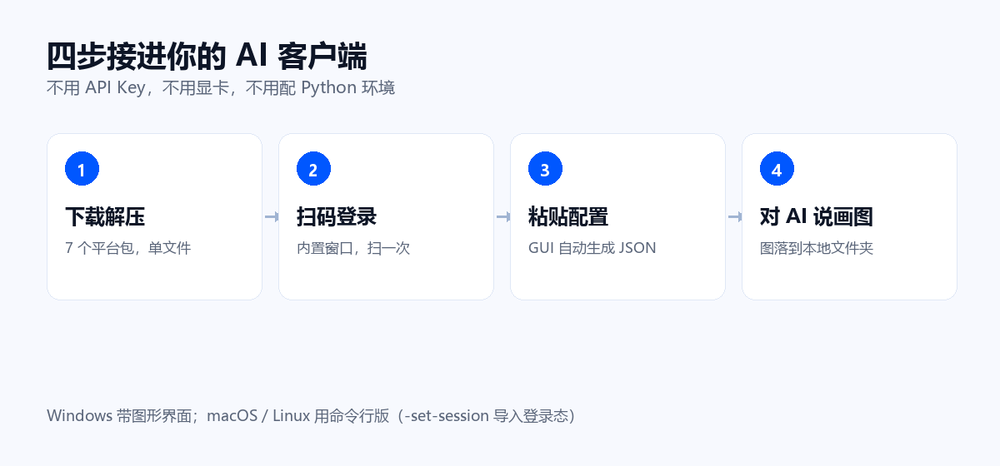
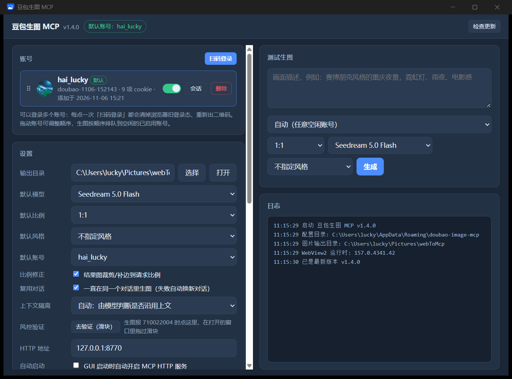
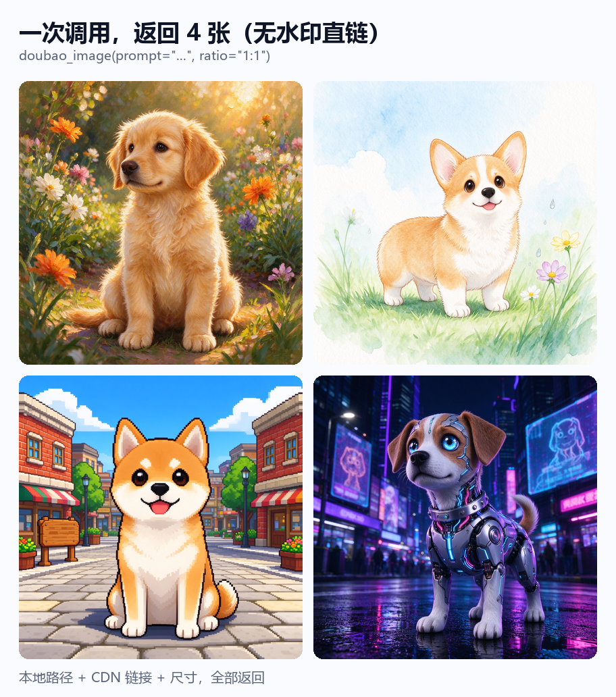
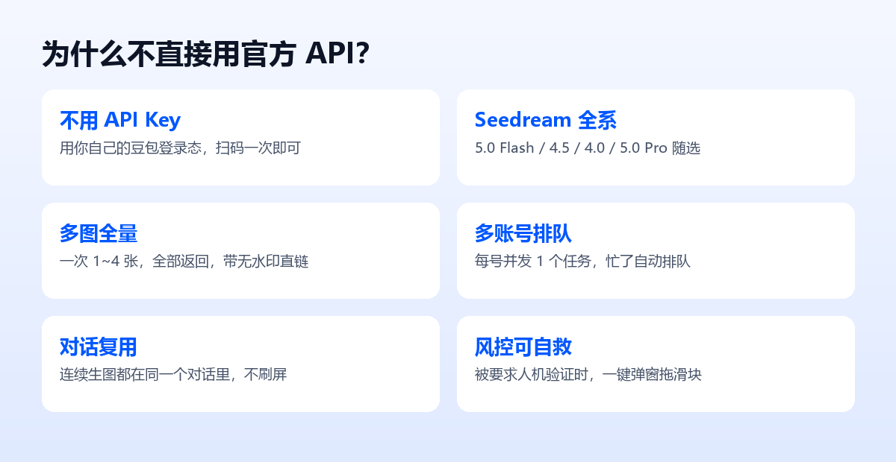

# 给 AI 客户端接上豆包画图：不买 API、不装显卡，四步搞定

先说结论：如果你只是想在 Claude Desktop / Cursor 里说一句「画张图」，有四种走法，差别其实很大。

| 方案 | 要 API Key | 要显卡 | 要配环境 | 上手时间 | 主要短板 |
| --- | --- | --- | --- | --- | --- |
| 豆包官方 API | ✅ 要，按量付费 | ❌ | ❌ | 有账号即可 | 要充值；免费额度有限 |
| 本地部署 SD / ComfyUI | ❌ | ✅ 8G+ 显存 | ✅ Python + 模型 | 半天起 | 吃硬件、调参重 |
| 其它豆包逆向脚本 | ❌ | ❌ | ✅ Python + 依赖 | 1 小时起 | 要改代码、自己接客户端 |
| **本项目（MCP）** | ❌ 不需要 | ❌ 不需要 | ❌ 单文件 | 约 5 分钟 | 非官方，接口变了会失效 |

最后一行是我做的：把豆包网页版的生图能力包成一个 MCP 服务，客户端直接调用，用的是你自己的网页登录态。



---

## 一、我为什么折腾这个

我日常画图的需求很碎：写文章要配图、做图标要试风格、给同事解释一个概念要张示意图。

之前的流程是：

1. 切到豆包网页
2. 找到输入框，把提示词贴进去
3. 等 20 秒
4. 右键图片 → 另存为 → 选目录 → 改名

一次两次还行，一天十次就很难受。更麻烦的是**「图在我脑子里，但我正在编辑器里写东西」**——每次都要打断思路去开浏览器。

所以我把它做成了 MCP：**在编辑器里直接说「画一张…」，图自己落到本地文件夹。**

## 二、四步接进来

### 第 1 步：下载解压

Windows 下载 `windows-x64.zip`（5.7 MB），解压，双击 `doubao-image-mcp.exe`。

单文件，不需要装 Python、不需要装 Node、不需要显卡。

### 第 2 步：扫码登录

程序里点「扫码登录」，弹出一个内置浏览器窗口（WebView2），用豆包 App 扫一下。

这里有个技术细节：豆包的登录态是 **HttpOnly 的 `sessionid`**，浏览器控制台里 `document.cookie` 读不到。所以我用的是原生 WebView2 窗口 + CookieManager，扫码完成后直接把 Cookie 取出来存本地，不是靠脚本读页面。

### 第 3 步：把配置粘进 AI 客户端

登录后，界面里「MCP 服务」卡片会自动生成一段 JSON，路径是当前机器的真实路径，直接复制：



```json
{
  "mcpServers": {
    "doubao": {
      "command": "C:\\你的路径\\doubao-image-mcp.exe",
      "args": ["-mcp"]
    }
  }
}
```

贴进 Claude Desktop 的 `claude_desktop_config.json`（或 Cursor 的 MCP 设置），重启客户端。

### 第 4 步：对 AI 说画图

```
用 doubao_image 画一张「雪山日落，16:9，电影感」
```

然后图就出现在你设置的输出目录里，同时返回本地路径和 CDN 链接。

## 三、用起来之后发现的三件事

### 1. 一次可能出好几张，必须都拿回来

豆包一次请求可能返回 1~4 张。很多脚本只取第一张，剩下的白扔了。

我这边是全部落盘、全部返回：



上面这张图就是**一次调用**出来的四种风格（同一提示词，不同风格参数）。

### 2. 每调一次就多一个对话，很难受

早期版本每画一张图，豆包侧边栏就多一条会话，两天就刷屏了。

现在默认**复用同一个对话**：第一次记住 `conversation_id`，后面都追加进去；对话失效了会自动新建。

顺带还加了个「上下文隔离」：因为复用对话意味着新提示词会看到前面的图，所以分三档——`auto`（模型自己判断要不要沿用上文）、`always`（明确要求忽略上文）、`none`（完全沿用）。想连着改同一张图就选后者。

### 3. 被风控时不该只能干等

豆包的风控有两档：`710022002`（限流）和 `710022004`（人机验证）。

后者会要求拖滑块。以前只能自己开浏览器去手动过一次，现在程序会**直接弹一个豆包窗口**让你拖，拖完关掉，重新生成即可。

原理是服务端在 `extra.decision` 里给了 `type: "verify"`，识别到就把验证窗口拉起来。

## 四、几个能力清单



- 6 个 MCP 工具：生图、扫码登录、滑块验证、模型列表、登录态检查、账号池
- 多账号：每个号并发 1 个任务，忙了自动排队
- 两种传输：stdio（客户端拉起进程）和 HTTP（常驻，多客户端共用）
- 自动检查更新：启动时查 GitHub Releases

## 五、说清楚短板

不想写成软文，几个坑必须说明：

1. **非官方实现**。走的是豆包网页版接口，属于逆向，服务端一改就可能失效。
2. **免费账号有额度**。额度用完要换号或等；触发 IP 风控（710022002/710022004）要冷却约 30 分钟。
3. **扫码窗口只有 Windows 有**。macOS / Linux 是命令行版，登录要手动从浏览器复制一次 Cookie 粘进去。
4. **图生图走旧通道**，比文生图脆弱，也拿不到会话 id。
5. **HTTP 模式没有鉴权**，默认只绑 `127.0.0.1`，别改成监听局域网。

## 六、地址

- 项目：https://github.com/haikuotianko/doubao-image-mcp
- 官网（含全部平台下载）：https://haikuotianko.github.io/doubao-image-mcp/

Windows 带图形界面，macOS / Linux 是命令行版，7 个平台的包都在 Release 里。

供个人学习自用，请遵守豆包用户协议。
