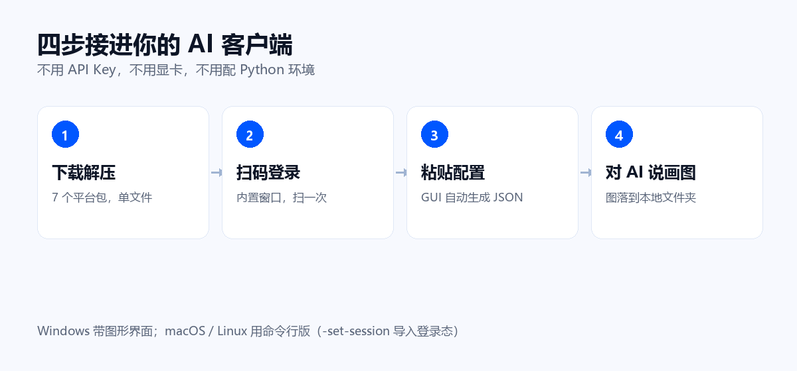
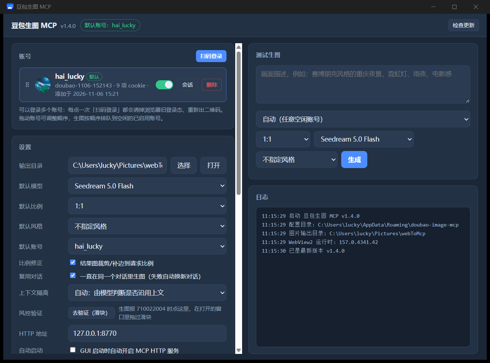
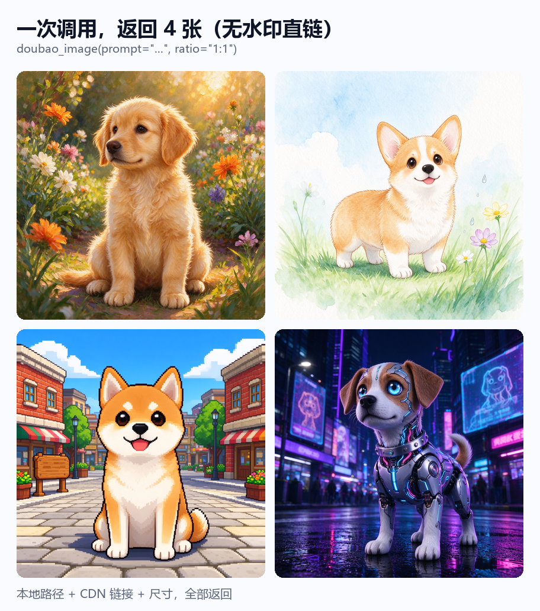

# AI IDE 里为什么画不了图？我给它补了个"外挂"

先说一个很多人踩过的坑：你用 Cursor 或 Claude Desktop 写代码，写到一半想让它"顺手画个图标/示意图"，结果它告诉你——我画不了。

不是它笨，是**大部分大模型根本不具备生图能力**。

## 一、主流大模型的生图能力对照

我按官方文档整理了一份（价格是 2026-11 的公开定价量级，仅作横向参考，具体以各家官网为准）：

| 模型 / 平台 | 原生支持生图 | 怎么用 | 计费量级 | 备注 |
| --- | --- | --- | --- | --- |
| ChatGPT（OpenAI） | ✅ 支持 | App 内直接画；API 用 `gpt-image-1` | 按质量/尺寸，约 $0.01–0.17/张 | 免费额度有限 |
| Claude（Anthropic） | ❌ 不支持 | 只能理解图片，不能生成 | — | 需外接 |
| Gemini（Google） | ✅ 支持 | App 内画；API 用 Imagen / Gemini Image | 约 $0.03–0.04/张 | 有免费额度 |
| Grok（xAI） | ✅ 支持 | X / Grok App；API 也提供 | 按张计费 | 风格偏"整活" |
| DeepSeek | ❌ 不支持 | 纯文本推理 | — | 需外接 |
| Kimi（月之暗面） | ❌ 不支持 | 纯文本 | — | 需外接 |
| 通义千问（阿里） | ✅ 支持 | 百炼 API 的「万相」系列 | 约 ¥0.1–0.3/张 | 国内访问快 |
| 豆包（字节） | ✅ 支持 | **网页版免费**；方舟 API 的 Seedream | API 按张计费 | 本项目走的就是它 |
| 智谱 GLM | ✅ 支持 | CogView 系列 API | 约 ¥0.1/张 | — |
| Llama（Meta） | ❌ 不支持 | 纯文本/多模态理解 | — | 需外接 |

看这张表就明白了：**AI IDE 里最常用的那几个（Claude、DeepSeek、Kimi）恰好都不会画图。**

## 二、这意味着什么

你在 Cursor 里写前端，想让它生成一个占位图、一个图标、一张 banner —— 只能：

1. 切到另一个 App 手动画
2. 或者给这个 IDE 单独接一套生图 API（还要买 Key、写适配）

而 MCP 提供的是第三种：**给客户端装一个"能力插件"**，模型本身不用变。

```
Claude / DeepSeek / Kimi（不会画图）
        ↓ 调用 MCP 工具
   doubao_image（真会画图）
        ↓
   本地图片文件 + CDN 链接
```

模型只需要会"调用工具"，生图这件事交给工具去做。

## 三、为什么选豆包做这个"外挂"

三个现实原因：

1. **网页版免费**。免费账号就能用 Seedream 5.0 Flash，不像其它家一开始就要充值。
2. **中文提示词理解好**。国产模型对中文描述的画面理解明显更准。
3. **一次能出多张**。同一个提示词，服务端可能返回 1~4 张不同风格，全部拿回来慢慢挑。

代价也明确：走的是网页接口（逆向），没有官方保证；免费额度有上限；触发风控要等冷却。

## 四、接进去只要四步



1. 下载解压（Windows 单文件 5.7 MB，无需 Python / Node / 显卡）
2. 扫码登录（内置 WebView2 窗口，取 HttpOnly 的 sessionid）
3. 复制界面自动生成的 MCP 配置，粘进客户端的配置文件
4. 在对话里说「用 doubao_image 画一张…」

之后 IDE 里的用法就变成了：

```
> 帮我画一个"设置"图标，线性风格，深蓝色

（AI 调用 doubao_image，20 秒后）
图片已保存到 C:\Users\you\Pictures\doubao-image-mcp\doubao_20261112_1130_1.png
```



## 五、实测下来值得说的几点

**1. 一次出多张，全部返回**



上图是**一次调用**的结果——同一个提示词，四种风格。很多脚本只取第一张，剩下的白扔。

**2. 连续画图不会刷爆侧边栏**

早期版本每画一张，豆包就多一个对话。现在默认复用同一个 `conversation_id`，还能设置"上下文隔离"三档，避免新图被上文干扰。

**3. 风控可以自救**

被要求人机验证（710022004）时，程序会弹出一个豆包窗口让你拖滑块，拖完关掉重试即可，不用自己开浏览器。

## 六、和"直接买 API"比，差在哪

说实话：

- **稳定性**：官方 API > 本项目。网页接口随时可能变。
- **并发**：官方 API 可以随便并发；这里每个账号同时只能跑 1 个任务（豆包对并发不友好）。
- **合规性**：官方 API 有服务协议背书；逆向实现没有。

所以它适合的场景很明确：**个人自用、量不大、想零成本把生图能力补进 AI 工具链**。

如果你是要做产品、要 SLA，还是老老实实买 API。

## 七、地址

- 项目：https://github.com/haikuotianko/doubao-image-mcp
- 官网（7 个平台下载）：https://haikuotianko.github.io/doubao-image-mcp/

Windows 带图形界面，macOS / Linux 是命令行版。开源 MIT，欢迎提 issue。

非官方实现，仅供个人学习自用，请遵守豆包用户协议。
